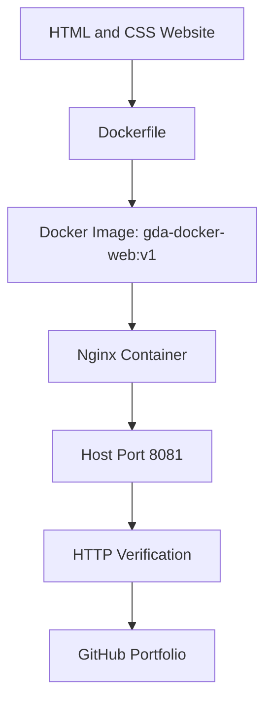

# Dockerized Web Application Deployment

**Organization:** Gondal Digital Agency (GDA)  
**Project:** DevOps Portfolio Project 01  
**Technology:** Docker, Nginx, Linux, AWS CloudShell, Git

## 1. Project Overview

This project packages a custom HTML/CSS website into a Docker image
and serves it using the Nginx web server.

## 2. Architecture



## 3. Technology Stack

- Docker image and container management
- Nginx web server
- HTML and CSS
- Linux command-line tools
- Git and GitHub

## 4. Project Structure

```text
devops-project-01-dockerized-webapp/
├── Dockerfile
├── README.md
├── site/
│   └── index.html
├── evidence/
│   ├── container-status.txt
│   ├── container-logs.txt
│   └── http-test.txt
└── scripts/
    └── verify.sh
```

## 5. Deployment Workflow

1. Create the website files.
2. Define the container image in the Dockerfile.
3. Build the Docker image.
4. Start the Nginx container.
5. Map host port 8081 to container port 80.
6. Verify container health and HTTP response.
7. Save test evidence and publish the source to GitHub.

## 6. Run the Application

Build the image:

```bash
docker build -t gda-docker-web:v1 .
```

Start the container:

```bash
docker run -d --name gda-docker-web -p 8081:80 gda-docker-web:v1
```

Test the application:

```bash
curl -I http://localhost:8081/
```

## 7. Testing and Evidence

The verification script checks the container state, HTTP status,
and expected website content. Results are saved in the evidence folder.

Actual test results and screenshots must be reviewed before publication.

## 8. Security and Limitations

- The current deployment is a local CloudShell test.
- Port 8081 is not automatically publicly accessible.
- No production domain, HTTPS, or public deployment is claimed.
- Do not store credentials, tokens, or AWS secrets in this repository.

## 9. Project Outcomes

The intended outcomes are a custom Docker image, an Nginx container,
a repeatable build process, and documented verification evidence.

Measured performance improvements are not claimed unless benchmarked.

## 10. Organization

Gondal Digital Agency  
Cloud Engineering | DevOps | Automation

## 11. Repository and Live Demo

GitHub repository: Add the verified repository URL after publishing.  
Live demo: Not configured; this project currently runs in CloudShell.
